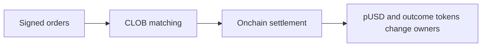

> ## Documentation Index
> Fetch the complete documentation index at: https://docs.polymarket.com/llms.txt
> Use this file to discover all available pages before exploring further.

# Prices & Orderbook

> How prices work and how the order book enables peer-to-peer trading

Polymarket uses a **Central Limit Order Book (CLOB)** for trading. Prices aren't set by Polymarket—they emerge from supply and demand as users trade with each other.


## Prices Are Probabilities

Every share on Polymarket is priced between `$0.00` and `$1.00`. The price directly represents the market's belief in the probability of that outcome.

| Price | Implied Probability |
| - | - |
| \$0.25 | 25% chance |
| \$0.50 | 50% chance |
| \$0.75 | 75% chance |

> [!NOTE]
>
> The displayed price is the **midpoint** of the bid-ask spread. If the spread
> is wider than \$0.10, the last traded price is shown instead.

### Example

If the best bid for "Yes" is `$0.34` and the best ask is `$0.40`:

```
Displayed price = ($0.34 + $0.40) / 2 = $0.37 (37% probability)
```

You won't necessarily trade at `$0.37`—you'll pay the ask (`$0.40`) when buying or receive the bid (`$0.34`) when selling.

## The Order Book

The order book is a list of all open buy and sell orders for a market. It has two sides:

| Side | Description |
| - | - |
| Bids | Buy orders—the highest prices traders are willing to pay |
| Asks | Sell orders—the lowest prices traders are willing to accept |

The **spread** is the gap between the highest bid and lowest ask. Tighter spreads mean more liquid markets.

## Order Types

### Market Orders

Execute immediately at the best available price. Use when you want instant execution and are willing to pay the spread.

* **Buying**: You pay the lowest ask price
* **Selling**: You receive the highest bid price

### Limit Orders

Execute only at your specified price or better. Use when you want price control and are willing to wait.

* Your order sits in the book until someone trades against it
* Orders can **partially fill** as different traders match portions of your order
* You can cancel unfilled orders at any time

> [!NOTE]
>
> All orders on Polymarket are technically limit orders. A "market order" is
> simply a limit order priced to execute immediately against resting orders.

## How Trades Work

Polymarket's CLOB is **hybrid-decentralized**:

1. **Offchain matching** — An operator matches compatible orders
2. **Onchain settlement** — Matched trades settle via smart contracts



This design gives you the speed of centralized matching with the security of onchain settlement. You maintain custody of your assets until a matched trade settles atomically.

The CLOB is shared across markets, while the settlement route depends on which system owns the outcome tokens: CTF or Polymarket Protocol V2.

## Price Discovery

When a new market launches, there's no initial price. The first price emerges when:

1. Someone places a limit order to buy Yes at a price (e.g., `$0.60`)
2. Someone places a limit order to buy No at the complementary price (e.g., `$0.40`)
3. Since `$0.60` + `$0.40` = `$1.00`, the orders match

When matched, `1 pUSD` of collateral creates a complete set through the market's owning system. The Yes and No outcome tokens go to their respective buyers. The reverse operation can merge a complete set back into `1 pUSD`.

## Next Steps

> [!NOTE]
>
> Polymarket's orderbook has **no trading size limits** — it matches willing
> buyers and sellers of any amount. However, large orders may move the price
> significantly. Always check orderbook depth before trading in size.

> **[Positions & Tokens](https://docs.polymarket.com/concepts/positions-tokens.md)**
>
> Learn about outcome tokens and how positions work.

> **[Order Lifecycle](https://docs.polymarket.com/concepts/order-lifecycle.md)**
>
> Understand what happens from order placement to settlement.


This documentation is built and hosted on [Mintlify](https://mintlify.com), a developer documentation platform.